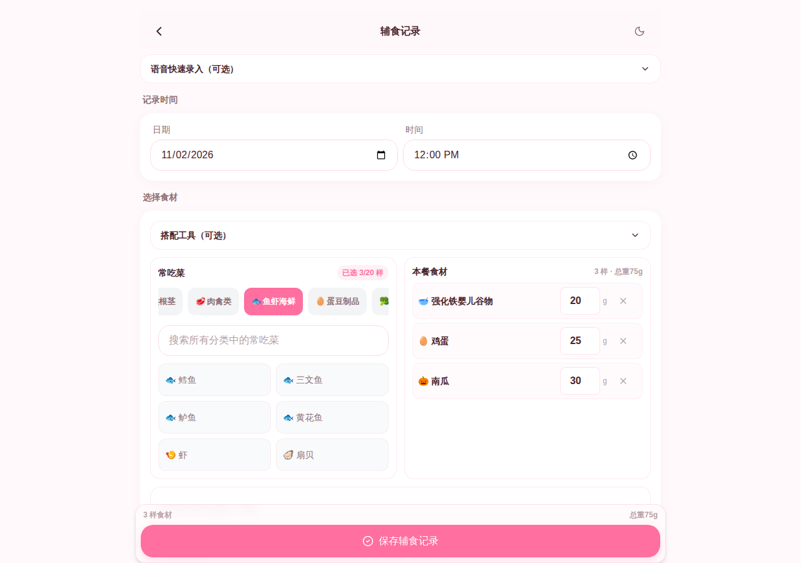

# FOOD_UI_20261102 visual review

Current-run capture: actual FoodLogPage + FoodLogForm + app/globals.css, with
synthetic test_ user/family/baby state at 127.0.0.2:3089. No production account,
production database, external provider, or image generation was used. Screenshots
are freshly captured and opened by root; they are not inferred from source.

Before, step 1: open create form. Captures before-320/390/768/1280-top/full.png.
At 390 the page is 2356px tall, with truncated recipe, wheel title and ingredient
names. Three narrow wheels put precise weight controls into stacked tiny labels.
At 320 document scrollWidth is 350px: date/time inputs overflow the visible page.
Nine category chips and a second full selected list appear below the wheel block.
On 1280 the form remains a narrow max-w-md column with unused horizontal space.
The primary ingredient chooser is below the first screen, and save is at the end
of the long form. Root inspected 320, 390 top/full and 1280 top before editing.

Fix target: make ingredient selection + selected meal the primary two sections;
use readable controls, expand to available width, and hide optional tooling behind
an explicit disclosure. Retain every existing ingredient/weight/edit capability.

After screenshots and acceptance notes are appended after visual inspection.
These UI fixtures do not validate authentication, transactions or production data.

## Final visual checks

Root opened matching before/after 390px screenshots together, then inspected the
final 320px, 390px, 768px and 1280px layouts, dark inputs, selected items, expanded
tools, custom-food entry, long legacy names and a 480px container in a 1280px viewport.

1. Open record page — PASS. Ingredient cards are on the first screen; optional
   voice and matching tools are collapsed. At 320px date/time stack so complete
   values fit; at 390px they remain side by side. The initial round's clipped
   native inputs and dark icons were rejected and corrected before this pass.
2. Choose foods — PASS. Categories scroll horizontally with the active category
   kept visible; search works across categories. Food targets are at least 52px
   high, category targets at least 44px. Multi-select has check marks and pressed
   state. The primary chooser is within the first 800px of the page.
3. Adjust meal — PASS. Long names wrap beside full-size weight inputs; removal
   remains available. Legacy unknown names remain visible. Unrecorded weights
   say "克数未记录", and partial measurements say "已知" rather than total zero.
4. Optional functions — PASS. Matching wheels, recipes/random choice, custom
   categories, fruit/oil library and extra meal observations remain reachable.
   They expand on demand, retain state and use the existing save callback.
5. Responsive/theme — PASS within captured states. All four widths have
   scrollWidth equal to viewport width; drawer layout stays one column based on
   its own width. Dark native calendar/clock icons are visible. Sticky save stays
   in the form's scroll flow and scrolling can bring the complete meal list into view.

390px default-page height changed from 2356 to 1652px; desktop changed from 2310
to 1400px, while primary targets got larger. This is supporting measurement,
not a substitute for the screenshots inspected above. No claim of complete
accessibility conformance, OS keyboard behavior, or production-account testing.

